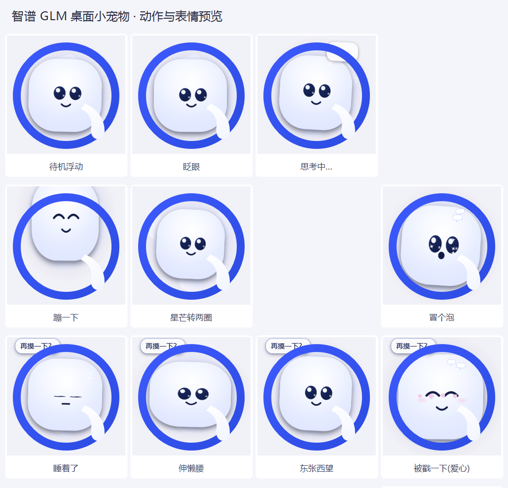

# 智谱 GLM 桌面小宠物 🐘

> 📦 **免安装下载**：[Releases](https://github.com/qi-cluadld/GLMPet/releases/latest) 下载 zip，解压后双击 `启动宠物.vbs` 即可（不用 clone、不用装任何运行库）。


一只趴在你桌面上的 **GLM（智谱清言）小象**：蓝色圆环 + 白色小象，会浮动、眨眼、转圈、思考、睡着，点它有反应，并和桌面上其它 AI 宠物（Gemini ✨ / DeepSeek 🐋 / ChatGPT ✦ / Claude ☀ / 豆包 🥟 / Qwen 🌀 / Copilot 🚀）互相打招呼、聊天、送爱心、吵架再和好。

- **零依赖**：只用 Windows 自带的 WPF + PowerShell
- **不抢焦点**：`WS_EX_NOACTIVATE | WS_EX_TOOLWINDOW`
- 形象照 GLM 图标做的：**蓝圆环 + 白象 + 象鼻**



## 快速开始
1. 双击 **`启动宠物.vbs`**（无控制台），出现在屏幕右下角；被拦截就用 **`启动宠物.bat`**
2. 左键 = 戳它；拖动 = 换位置；右键 = 菜单（打招呼 / 摸摸头 / 大小 / 退出）
3. 开机自启：`启动宠物.vbs` 的快捷方式丢进 `shell:startup`

## 联动
共享内存 `DesktopPets.Interop.v4`（8 槽位），谁在跑就跟谁联动：见面打招呼 / 真对话（带话题记忆）/ 说话气泡 / 一起玩 / 传爱心 / 追逐 / 吵架和好 / 排排站 / 串门 / 让位 / 边界保护。台词与话题在 `lines.json`。

## U 盘热插拔自动备份
双击 **`启动U盘备份.vbs`**，之后每次插入 U 盘自动备份到 `<U盘>\桌面小组件\`。

## 文件与开发
```
GLMPet\
├─ GLMPet.ps1        主程序(单文件可独立运行)
├─ social.ps1         十二只共用的联动模块
├─ lines.json         台词表与话题表
├─ glm_pet.ico/.png   图标
├─ 启动宠物.vbs / .bat / 启动U盘备份.vbs
├─ build\             角色代码块 + build.ps1
├─ tools\             shot.ps1 / make_assets.ps1 / usb_backup.ps1
└─ preview\           12 张动作预览 + 合集图
```

## 同系列（十二只）

| 宠物 | 品牌 | 仓库 |
| --- | --- | --- |
| 小星星 ✨ | Gemini | https://github.com/qi-cluadld/GeminiPet |
| 小鲸鱼 🐋 | DeepSeek | https://github.com/qi-cluadld/DeepseekPet |
| 小花 ✦ | ChatGPT | https://github.com/qi-cluadld/ChatGPTPet |
| 小太阳 ☀ | Claude | https://github.com/qi-cluadld/ClaudePet |
| 小豆包 🥟 | 豆包 | https://github.com/qi-cluadld/DoubaoPet |
| 小千 🌀 | 通义千问 | https://github.com/qi-cluadld/QwenPet |
| 小飞 🚀 | Copilot | https://github.com/qi-cluadld/CopilotPet |
| 小象 ⭕ | 智谱 GLM | https://github.com/qi-cluadld/GLMPet |
| 小格 ⚔ | Grok | https://github.com/qi-cluadld/GrokPet |
| **小谷** | 渐变 G（2025） | [GoogleGPet](https://github.com/qi-cluadld/GoogleGPet) |
| **小彩** | 扁平四色 G（2015） | [GoogleFlatPet](https://github.com/qi-cluadld/GoogleFlatPet) |
| 小智 ✨ | Apple Intelligence | https://github.com/qi-cluadld/ApplePet |

十二只可以**同时运行并互相联动**：打招呼、真对话（带话题记忆）、传爱心、追逐、吵架和好，以及**一对一打架**。
一键安装包（含十二只，可自选）：https://github.com/qi-cluadld/DesktopPetsInstaller/releases
## License
MIT